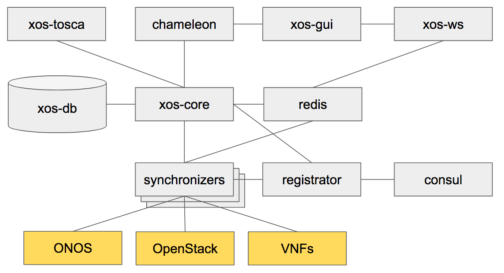

# XOS Internal

XOS, often referred as the CORD orchestrator, is the unique source of truth in a CORD installation. Here is an overview of its structure.

> Please note that this page is far from being complete, and help in extending it is really appreciated.

# Containers

XOS is constituted of a set of Docker containers that cooperate to provide the platform functionalities.

Here is an inventory of those containers:

| Name | Description | Ports |
| ---- | ----------- | ----- |
| xos-core | The core of the platform, contains the model definition and the xProto toolchain | 50051, 500515 |
| xos-db | The Postgres instance that persist the data-model | 5432 |
| xos-redis | A Redis instance, used as pub/sub channel for internal notifications | 5432 |
| xos-tosca | Northbound TOSCA interface, accessible via REST at `/xos-tosca`| 9102|
| xos-gui | Northbound GUI interface, accessible at `/xos`| 4000|
| xos-ws | Listen to `redis` events and propagate them over web-sockets for notifications| 3000|
| xos-chameleon | Northbound REST interface, accessible at `/xosapi/v1/..` (`swagger` is published at `/apidocs/`| 3000|

On the side of those, we deploy some infrastrucure helpers such as `consul` and `registrator` to facilitate service discovery.

All the communication between container happens over `gRPC` except for `xos-gui` where it is a combination of REST and Web-socket.

